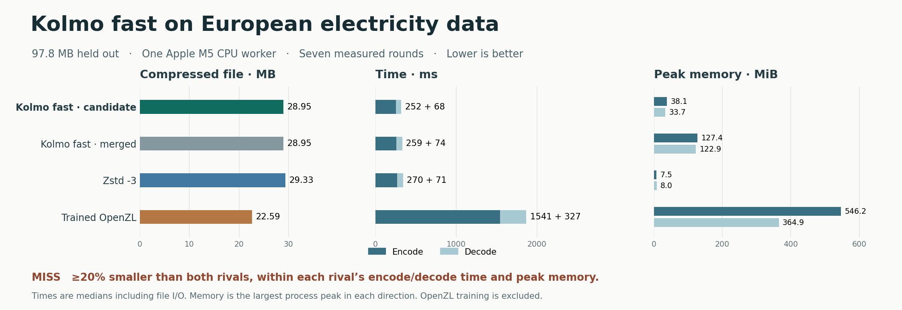

# Kolmo fast on fresh electricity data

The frozen candidate cut peak RSS by 70.1% during encoding and 72.6% during decoding compared with merged PR #1. Median encode time fell by 2.8% and decode time by 8.2%. Both Kolmo builds emitted identical bytes.

Kolmo produced 1.3% fewer bytes than Zstd -3 and 28.2% more bytes than trained OpenZL. It met both competitors’ time limits, exceeded Zstd’s memory limits, and missed the 20% size target against both competitors.



The source was the 2020-10-06 Open Power System Data hourly series of European electricity load, generation, capacity and prices. The final 37,801 records (97,758,157 bytes including the header) were held out. OpenZL trained on the earliest 1,655 records (4,192,040 bytes). Its offline training took 42.8 seconds with 629.8 MiB peak RSS and produced a 7,068-byte encoder graph. The stock OpenZL decoder restored the complete frame without that graph. [Dataset and attribution](https://doi.org/10.25832/time_series/2020-10-06)

| Build | Output bytes | Input/output ratio | Encode ms | Decode ms | Encode MiB | Decode MiB |
|---|---:|---:|---:|---:|---:|---:|
| Kolmo fast candidate | 28,952,355 | 3.38× | 252.02 | 67.53 | 38.11 | 33.72 |
| Kolmo fast, merged PR #1 | 28,952,355 | 3.38× | 259.16 | 73.54 | 127.39 | 122.94 |
| Zstd 1.5.7 -3 | 29,330,836 | 3.33× | 269.60 | 71.21 | 7.50 | 8.00 |
| Trained OpenZL 0.3.0 | 22,590,467 | 4.33× | 1540.96 | 326.81 | 546.23 | 364.91 |

One Apple M5 worker per codec, with one warm-up and seven randomized serial rounds on newly created output paths. Each time is the median end-to-end CLI wall time. Each memory figure is the largest per-process peak RSS observed for its stage. Startup and file I/O are included. macOS schedules the CPU and manages the filesystem cache. Peak RSS excludes the system-wide file cache. All 32 decodes reproduced the source hash. [Frozen protocol](protocol.md) · [Binary and input hashes](freeze.json) · [Raw trials and training cost](trials.json)

| Rival | ≥20% fewer bytes | Encode time | Decode time | Encode memory | Decode memory |
|---|---|---|---|---|---|
| Zstd 1.5.7 -3 | Miss | Pass | Pass | Miss | Miss |
| Trained OpenZL 0.3.0 | Miss | Pass | Pass | Pass | Pass |

Each pass uses the unrounded incumbent measurement with zero slack. A candidate must pass every column against both rivals.

A post-score inspection of the candidate frame (SHA-256 `42bd449e56b94ac2517235790b7f2596492ff05a0bd053fdf1369d714215fe1f`) found 24 blocks, all with codec 3 (Zstd) and transform flag 0. The file has 300 columns. The current table detector supports up to 256 columns and requires 51 sampled lines within its 64 KiB probe. The probe on this file spans only 23 lines including its trailing partial row. Supporting wide tables is a concrete follow-up to test on another unseen source.

## Prior fast workloads

Each workload had one warm-up and five randomized timed pairs against the merged build. All candidate frames matched the recorded pre-change SHA-256 and every decode matched the original source. Negative deltas mean fewer milliseconds or fewer MiB. Small changes on short files are sensitive to process startup and desktop load. [All regression trials](regression.json)

| Workload | Encode time Δ | Decode time Δ | Encode peak MiB, merged → candidate | Decode peak MiB, merged → candidate |
|---|---:|---:|---:|---:|
| archive | -1.3% | -9.5% | 335.2 → 137.1 | 273.6 → 75.5 |
| tables | -2.0% | -0.9% | 40.5 → 25.2 | 15.2 → 6.2 |
| numbers | +1.2% | -1.2% | 11.7 → 11.7 | 6.4 → 6.5 |
| genome | +0.0% | +2.8% | 10.4 → 10.4 | 7.9 → 7.9 |
| image | -2.2% | +0.1% | 9.3 → 9.2 | 6.1 → 6.1 |
| audio | -0.1% | +0.3% | 18.4 → 18.3 | 9.5 → 9.5 |
| video | -0.7% | -0.7% | 31.3 → 21.7 | 21.8 → 12.3 |
| power | -1.5% | -6.2% | 164.4 → 65.1 | 109.0 → 18.0 |
| rides | -3.3% | -4.6% | 22.1 → 10.4 | 20.4 → 8.7 |
| quakes | -0.3% | -1.8% | 7.6 → 7.6 | 6.0 → 6.0 |

## Implementation and replay

Starting at 8 MiB, the default fast CLI maps a regular input for planning, releases that mapping, and reads individual compression blocks by offset. Decoding reuses a per-worker block buffer and writes verified blocks to a temporary file. A verified new destination can be published by linking the file. Replacing an existing destination may require copying it to preserve links and permissions. Small files keep the memory path. The table transform reuses scratch across independent columns. The input mapping during planning, compressed frame, temporary disk usage and number of workers still affect resource use. These measurements cover one CPU worker and fresh output paths.

Use the source in the freeze manifest and the four matching executables. The first commit contains the code, the next pins the candidate before evaluation. The scorer verifies all binary and dataset hashes before measuring. Offline training is time-limited and may produce a different graph on another run. The [original trained graph](opsd.zlc) also allows a replay of the measured OpenZL encoder by passing it to `zli compress --compressor`.

```sh
python3 benchmark/electricity/run.py score opsd.csv build/replay \
  --candidate /path/to/candidate --merged /path/to/merged \
  --zstd /path/to/zstd --openzl /path/to/zli
python3 benchmark/electricity/chart.py
```
