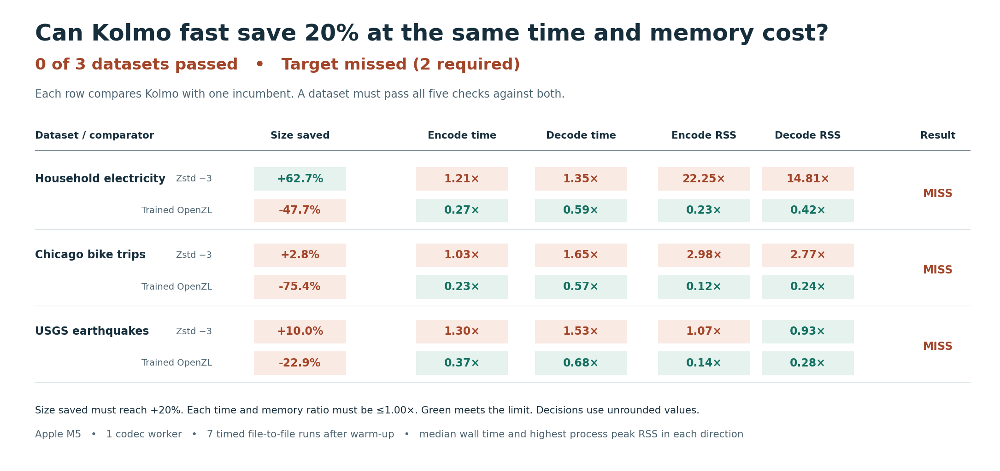

# Frozen Kolmo fast evaluation

**0/3 datasets passed.** Two passes were required. Each pass needs at least 20% fewer bytes and no increase in either time or peak resident memory against both incumbents. [Frozen protocol](protocol.md)

Kolmo fast used 62.7%, 2.8% and 10.0% fewer bytes than Zstd -3 on electricity, bike trips and earthquakes respectively. Trained OpenZL produced smaller files on every dataset. Kolmo took less time and peak RSS than OpenZL in both directions on all three datasets. The release and current fast encoders produced equal-sized files on all three. As a next experiment, measure whether bounded streaming can preserve the electricity size advantage while closing the measured 164.4 versus 7.4 MiB encode RSS gap against Zstd.

## Shipping 1.0.0 versus this build

Across the seven previous chart inputs and six shipping modes, 42/42 compressed sizes matched and 42/42 complete frames were byte-identical. Both cross-version decoders restored every input in both directions across the 42 cases. The archive ultra candidate used the previously captured and hash-verified default-equivalent cap22 frame. Every other frame was encoded in this replay. Fast timings below are fresh paired file-to-file measurements from the actual Homebrew release and the frozen current executable on an Apple M5. Five timed observations follow a warm-up per binary and dataset. Percentages express change in throughput.

| Prior chart input | Release enc → current MB/s | Change | Release dec → current MB/s | Change |
|---|---:|---:|---:|---:|
| archive | 289.2 → 309.0 | +6.9% | 1216.5 → 1357.0 | +11.6% |
| tables | 259.7 → 276.8 | +6.6% | 615.6 → 690.6 | +12.2% |
| numbers | 112.4 → 178.7 | +58.9% | 440.7 → 447.3 | +1.5% |
| genome | 292.7 → 299.6 | +2.3% | 704.7 → 781.8 | +10.9% |
| image | 57.7 → 86.7 | +50.4% | 211.3 → 213.6 | +1.1% |
| audio | 154.0 → 199.2 | +29.3% | 518.4 → 612.4 | +18.1% |
| video | 193.0 → 227.1 | +17.7% | 576.2 → 673.7 | +16.9% |

The Homebrew formula archive, PyPI kolmoc 1.0.0 source distribution and kolmo 1.0.0 crate had 285 matching native and vendored files. Cargo records an earlier packaging commit. On a separate 256 KiB CSV excerpt we built the two registry bindings on this Mac and verified all 96 encoder/decoder combinations across pip, Cargo, Brew and current. On this excerpt, ultra changed the version byte and its header CRC, with identical payload and length. Python Linux wheel and Rust wrapper call overhead are outside the reported CLI timings. [Registry hashes](release-provenance.json) · [Binding probe](bindings-compatibility.json)

### Parallel fast path

Ten CPU workers, five measured pairs following one warm-up. These are supplementary release measurements on the original planning workloads.

| File | Encode MB/s, 1.0 → current | Decode MB/s, 1.0 → current |
|---|---:|---:|
| mozilla | 183 → 857 | 3238 → 3446 |
| nci | 568 → 563 | 2898 → 2874 |
| owid-co2-data.csv | 773 → 806 | 1738 → 1833 |

## Unseen structured files

All timed runs used one CPU worker, identical scored bytes and fresh command-line processes. Encode/decode are medians including startup and file I/O. RSS is the largest observed per-process peak in seven measured runs. Offline OpenZL training is reported separately. Complete graph-independent frames were counted. Each decode reproduced the source SHA-256. Each round used a randomized order of codecs, run serially. Desktop load and CPU placement were uncontrolled. These are observed incumbent budgets, with no added slack. Public datasets are proxies for deployment workloads.

| Dataset | Encoder | Output bytes | Encode ms | Decode ms | Encode MiB | Decode MiB |
|---|---|---:|---:|---:|---:|---:|
| power | kolmo | 6,422,952 | 205.38 | 91.58 | 164.41 | 109.02 |
| power | release | 6,422,952 | 226.20 | 98.18 | 167.62 | 108.92 |
| power | zstd | 17,220,759 | 169.41 | 68.06 | 7.39 | 7.36 |
| power | openzl | 4,348,202 | 765.02 | 155.02 | 711.00 | 259.55 |
| rides | kolmo | 2,654,725 | 28.17 | 15.67 | 22.14 | 20.41 |
| rides | release | 2,654,725 | 29.18 | 16.82 | 22.02 | 20.34 |
| rides | zstd | 2,731,686 | 27.45 | 9.49 | 7.44 | 7.38 |
| rides | openzl | 1,513,512 | 121.40 | 27.43 | 191.67 | 84.48 |
| quakes | kolmo | 612,178 | 11.48 | 6.10 | 7.64 | 5.98 |
| quakes | release | 612,178 | 12.25 | 6.77 | 7.94 | 5.92 |
| quakes | zstd | 680,257 | 8.82 | 4.00 | 7.11 | 6.45 |
| quakes | openzl | 498,311 | 31.42 | 8.95 | 55.44 | 21.44 |

### Frozen inputs and training

Source order and bytes were retained, with the header shared. Training used a prefix in the first quarter (up to 4 MiB). The final three quarters of records were scored. No held-out rows were used for model selection. [Input and train/test hashes](inputs.json) · [Binary and source freeze](freeze.json)

- [power source](https://archive.ics.uci.edu/static/public/235/individual+household+electric+power+consumption.zip) — 1,556,445 scored records, 99,631,060 bytes. OpenZL trained on 64,626 records in 13.1 s, producing a 11,144-byte encoder graph.
- [rides source](https://divvy-tripdata.s3.amazonaws.com/202201-divvy-tripdata.zip) — 77,828 scored records, 13,998,547 bytes. OpenZL trained on 21,762 records in 15.0 s, producing a 10,396-byte encoder graph.
- [quakes source](https://earthquake.usgs.gov/fdsnws/event/1/query?format=csv&starttime=2020-01-01T00:00:00&endtime=2020-02-01T00:00:00&orderby=time-asc&limit=20000) — 13,135 scored records, 2,424,830 bytes. OpenZL trained on 4,378 records in 13.5 s, producing a 11,868-byte encoder graph.

The Silesia ultra size win belongs to release 1.0.0 as well as this build. The independent KBX and Metal experiments are separate from the fast CLI tested here. The integration candidate focuses on shipping code, including concurrency and resource handling plus parallel block planning. A passing compatibility suite does not establish a competitive time or memory win.

[Decision metrics](decision.json) · [Holdout trials](holdout-runs.json) · [Release trials](release-runs.json) · [Parallel release trials](release-scaling.json)
