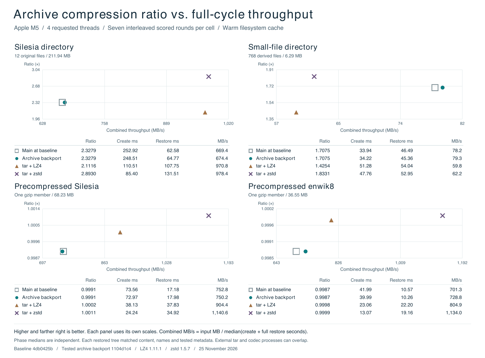

# Kolmo release candidate and competitive benchmark handoff

**25 November 2026.** The accepted main revision is `a1d39559686a9ec17c8614b9154a64d7b5b98672`. The unpublished v0.0.3 RC branch is `release/0.0.3-prep`, commit `a2e430fed2fbc6dc357a78651cadf0e1fed611f2`. Its Git tree is `5288b50e182d02d48b81e628f31e03056378689a` and includes the accepted main as a parent. The prior RC, evidence and release tag remain addressable. Exact source for main, the current RC and release approval items are [here](https://github.com/adnaneben/kolmo/commit/a1d39559686a9ec17c8614b9154a64d7b5b98672) and [here](https://github.com/adnaneben/kolmo/pull/47).

[Continuing competitive objective, scoring and admission rules](competition-protocol.md) · [Original artifact in this PR](../UltraPlus-and-Archive-Evidence.zip) · [Tracker](https://github.com/adnaneben/kolmo/issues/57)

## Accepted for main and the RC

- The Python wrapper copies the actual compressed length once. Seven randomized pairs on three real files produced identical frames and saved 29–202 MiB of process RSS. Another 45 paired settings covered empty, tiny and 2 MiB inputs, three levels and T1/T4/auto. [Original review](https://github.com/adnaneben/kolmo/pull/52) · [Landing PR](https://github.com/adnaneben/kolmo/pull/92).
- DDP1 archive listing and selected extraction walk the recipe once. The earlier 1,024-member listing took 47.26 ms before and 3.55 ms after. A single, large (at least 32 MiB), unique RT archive member can reuse a disjoint input buffer. Both source changes were ported to main independently of the Wave 2 staging change. The main-backport tests cover overlap, missing and empty members and archive order. [Walker](https://github.com/adnaneben/kolmo/pull/87) · [Scoped direct store](https://github.com/adnaneben/kolmo/pull/89) · [Combined source review](https://github.com/adnaneben/kolmo/pull/90).
- The RC fixes the package summary and distribution contents. The actual sdist, wheel built from that sdist and rebuilt Rust crate passed package checks. The wheel contained the required notices and no loose object files. Native release validation included 630 frozen C frames, 734 pinned files, 152 deterministic frames, a 571-entry byte-size ledger, 3,712 normal and 3,744 sanitizer feature checks and bidirectional v0.0.2 archive tests. Public tag, registry publication, yanks, advisory disposition and checks on hosted release artifacts remain separate.

## Latest archive frontier

Every plot uses input bytes / archive bytes on the vertical axis and input bytes / elapsed creation plus full restore time on the horizontal axis. Dots compare the same workloads, including framing and filesystem work. Columns give independent phase medians. All four products restored the expected file names, content and tested metadata. The tar encoder/decoder processes may overlap with the codec. Warm local cache, Apple M5, seven scored repetitions per cell. See the separate randomized 15-triplet A/A confirmation for close results.

[One-thread chart](archive-t1.png) · [Both thread levels, exact raw and archived bytes, phases, CPU and RSS](archive-clean.csv) · [Wave 2 / #90 diagnostic cells](archive-waves.csv) · [Earlier levels 1–Ultra graph](levels-1-ultra.pdf) · [Earlier levels annotated CSV](levels-1-ultra.csv) · [Method and definitions](archive-measurements.md) · [Raw observations, controls, hashes and replay](archive-experiment.tar.gz)

- At T4, Silesia and enwik8 gzip single-member confirmation showed 3.6–4.6% paired throughput gains over two independently sampled main controls. Stored bytes matched exactly. The initial seven-pair marginal median speeds and the confirmation's paired ratios measure different statistics and both are retained. In particular, the Silesia gzip independently calculated seven-round medians put the candidate at 750.16 MB/s and baseline at 752.84 MB/s.
- On the uncompressed 12-file Silesia directory, T4 combined reached 674.44 MB/s for the clean candidate, 970.78 for tar+LZ4 and 978.39 for tar+zstd. On the 768 small-file layout it reached 79.25, 59.79 and 62.18 MB/s respectively. Zstd produced the smallest stored output in both cases. The small-file result describes the competitive position of this build; the clean change did not establish a new improvement over main for this layout.
- An additional modeled crossover uses create + restore + one serialized transfer. On Silesia, Kolmo saves 9,327,693 bytes versus LZ4 at +95.92 ms local elapsed time. Its projected break-even transfer rate is 97.24 MB/s. On the 768-file layout Kolmo costs 252,543 bytes versus zstd but saves 21.80 ms locally, giving 11.58 MB/s. These are deployment-model projections and assume zero overlap and one transfer.

## Review reconciliation

The latest audit reconciled 40 initial assignments, 60 second-wave assignments, 12 follow-ups and 11 later investigations. The 123 ledger rows describe 68 grouped subjects. An earlier independent Claude campaign has 40 reports or reassessments and 178 claim IDs. Its next ledger repeats those claims with annotations. The authorship records alone do not prove blind independence. The 348-run regression audit and matched controls did not reproduce the earlier large FASTQ, BF16, BGL or IMG16 whole-wave slowdowns.

[Reviewer-level decisions](review-map.csv) · [Claude's 178 claim IDs](claude-legacy-claims.csv) · [Outstanding work and corroboration](reviewer-summary.md) · [Complete records and regression replays](reviewer-closure.tar.gz).

## Research completed

| Question | What the experiment established | Decision |
| --- | --- | --- |
| Can bounded LZ parsing improve level 1? | On 32 transfer slices exact-cost phrase repair saved 2.18% of raw-codec bytes in aggregate and added 12.55% more phrases. The actual single-pass variant shrank every one of 24 tested cells, but ratio × combined throughput fell 5.53–78.37%. | Reject this implementation. A future budgeted parser needs lower search cost and avoidance of short expensive copies. [Report](research-klz.md) · [Replays and patch](research-klz.tar.gz). |
| Can a confidence-gated additional expert improve Ultra+? | Across 36 real coder/file/layout comparisons the best size gain was 0.04961%; three regressed. All 240 arm decodes were exact. Eight bytes saved at 256 KiB enwik8 permit only 0.01235% more round-trip time before the product score falls. | Reject this expert. Attribute coding loss and processing time to record fields and short/no-match contexts before adding more experts. [Report](research-cm4.md) · [Replays and diagnostics](research-cm4.tar.gz). |
| Can existing levels be selected without training? | The 80-cell hindsight screen suggests 14 alternative settings under simultaneous size/time/RSS limits, including ties in stored size, using only three repetitions. The product-optimal preset on the eight sources was level 1 five times, level 2 once, and level 3 twice. A product ranking by itself rarely selects Ultra. Real image transfer across 192 CLI trials and 31 released-reader checks showed L7→3 increased bytes in 12/16 cells despite higher product in every cell. | Preserve MR prefix as a speed-priority observation. Reject a format-wide substitution. An independent GE DICOM grew 64.18% on its 256 KiB prefix. [Hindsight screen](level-frontier.csv) · [Transfer report](image16-transfer.md) · [Replays](image16-transfer.tar.gz) · [Unsealed L4 hypothesis](image16-level4-hypothesis.md). |
| Does private extraction staging preserve speed? | Original #59 was 2.13–2.88× slower on eight small-file contexts. Unconditionally caching the stage regressed on directories with a single file. A gated design kept atomic replacement and reduced flat-tree restore time 29.5–51.3% relative to #59. It still took 1.30–1.75× main's direct-write time. | Keep [#94](https://github.com/adnaneben/kolmo/pull/94) as a security/performance draft. [Scoped rechecks](atomic-stage.md) · [All implementations and raw results](atomic-stage-research.tar.gz). |
| Is parsed-index reuse a 15× main improvement? | The reported 14.85–16.96× was against the intermediate Wave 2 budget path. The direct-main backport took 2.36–6.06% less decode time under the tested 2 MiB limit, with mixed unrestricted timings. | Keep [#93](https://github.com/adnaneben/kolmo/pull/93) separate. It contains the valid-input admission tests and 704 benchmark arms. |

## Next competitive decisions

1. On fast archives, profile creation on real directory snapshots; separate file discovery/I/O, CDC, chunk hashing, ordered interning and final codec work. Qualify bounded parallel chunk work and bounded I/O overlap on two file systems, natural version histories, tiny files and peak RSS. Distinguish many-name extraction cost from recipe traversal.
2. For Ultra+, the earlier 256 KiB released-reader control yielded 61,966 bytes in 0.30 s encode + 0.27 s decode, versus PAQ8PX v217 -8L at 54,648 bytes in 90.41 + 104.65 s. The prefix and pre-existing single paired runs establish the trade-off only there. Same-host full enwik8 with PAQ8PX and cmix remains open. Use dedicated ≥32 GB hardware (64 GB preferred for margin) and disclose dictionary/weights, cold initialization, CPU and actual wall/RSS. Track any leaderboard that counts the decoder with the payload using its published rules.
3. Sequester previously unseen producer families for source code, logs, model weights, typed records, random-access archives and encrypted/precompressed files. Introduce versioned encoder-side policy only after testing fallback, ordinary v12 decoding, rollback and the complete cost of unsuccessful probes. GR6 and Lexi need incremental wins over the native preset with shipping-reader compatibility. Keep ISA paths separately eligible; require an actual scalar reference and native x86 and ARM comparison for broad defaults.
4. For untrusted archives prioritize a bounded worker, per-member/whole-tree publication semantics, release provenance checks and authenticated encryption over the complete archive. Separate key and deployment threat models from compression ratio. The RC package-content checks cannot attest the future hosted artifacts.
5. Confirm remaining release decisions in #47, particularly the advisory and release date, then verify the exact downloadable assets before a production release. [Hosted x86 comparative benchmark](https://github.com/adnaneben/kolmo/actions/runs/45651729800).

Research references include the [bicriteria LZ parsing result](https://pages.di.unipi.it/frangio/papers/BiCriteriaCompression.pdf), [adaptive context mixing](https://repository.fit.edu/ces_faculty/166/), [cmix hardware guidance and reference sizes](https://byronknoll.com/cmix.html) and [Large Text Compression Benchmark rules](https://mattmahoney.net/dc/text.html).

## Source and RC verification

The dedicated [CI-only RC draft #96](https://github.com/adnaneben/kolmo/pull/96) and its synthetic pull ref both resolved to the exact candidate. The release branch and GitHub compare resolved to that same candidate while the older PR #47 synthetic head still resolved to its prior commit. Use [the exact CI run](https://github.com/adnaneben/kolmo/actions/runs/45652253786) for qualification. The original ZIP was read again from the augmented evidence tree at blob `7b4cfed0cdd6cce28b97da5ab6fabe4383f136e1`.
 
Follow-up code has its own reviews. [#95](https://github.com/adnaneben/kolmo/pull/95) aligns the archive writer with the existing 4,096-byte on-wire name bound. [#97](https://github.com/adnaneben/kolmo/pull/97) addresses duplicate and missing request accounting plus binary search of requested names. Full restoration of 512 requested members from an 8,192-member archive got faster in all seven pairs at both T1 and T4. Selection without a stored member, which only exercises lookup, is a separate measurement. The lower request-count cells and platform controls remain relevant to promotion.

## Native Ultra results

The 86 exact file-to-file trials tested what the shipping-compatible CLI actually emits. On three 256 KiB source spans at T4, forcing four 64 KiB blocks gave 1.81–2.92× combined throughput in seven of seven paired trials per source. Output grew 14.02–20.14% and peak RSS rose in both phases. Retain the existing explicit block-size option for speed-priority use. There is no default ratio improvement from raising the 128 MiB target on inputs already encoded in one block.

On 8.5 MiB Dickens and enwik8 spans under a 256 MiB limit, increasing the target from 8 to 16 MiB saved 1.31–1.36% of complete archive bytes. Combined speed rose about 6% at T1 and fell about 6–7% at T4 in single runs. These phase timings need independent repetitions before adopting a new policy. [Results and block layouts](ultra-native.md) · [Native source, receipts and replays](ultra-native-replay.tar.gz) · [RC qualification](rc-qualification.md) · [Local RC receipts](rc-local-checks.tar.gz).

A further 960 exact restores of valid selected files (864 scored, 96 warmups) tested #97 and a direct-one-name alternative in independent randomized sessions against two executions of the same main binary. At 512 requests out of 8,192 entries, #97's combined restore speedup was 1.104–1.116× across T1/T4 and both controls, faster in every one of nine scored rounds per comparison. The direct-one-name alternative gave 1.111–1.145× in that large-selection cell. The small-selection results changed direction across controls or builds. The alternative still ran 2.1–2.5% slower for one name out of 8,192 at T4 against both controls. Keep #97 in review; do not promote the alternative on a one-name performance claim. The absent-name lookup experiments measure different work from successful restore. [Both independent replay sessions](selection-qualification.tar.gz).
