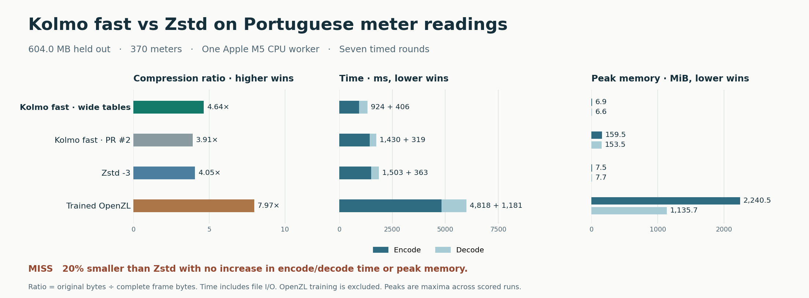

# Wide-table fast benchmark

Kolmo wrote 12.6% fewer bytes than Zstd -3 and took 38.5% less time to encode the frozen Portuguese meter data. It used less peak memory in both directions. Decode time rose 11.8%. The target requires at least 20% fewer complete bytes and no increase in either stage’s time or peak RSS.



## Fresh Portuguese meter readings

The scored input contains 105,192 consecutive records and 603,951,209 bytes. All 370 meter columns, the timestamp and the original text formatting were retained. The final three quarters were held out. OpenZL trained on the earliest 1,384 rows (4,193,980 bytes). That one offline training run took 32.7 s and 482.1 MiB, excluded from operational costs. [Trindade, 2015, UCI ElectricityLoadDiagrams20112014](https://doi.org/10.24432/C58C86)

| Codec | Frame bytes | Ratio | Encode ms | Decode ms | Encode MB/s | Decode MB/s | Encode peak MiB | Decode peak MiB |
|---|---:|---:|---:|---:|---:|---:|---:|---:|
| Kolmo fast, wide tables | 130,249,618 | 4.64× | 924.14 | 405.85 | 653.5 | 1,488.1 | 6.92 | 6.59 |
| Kolmo fast, PR #2 | 154,614,457 | 3.91× | 1,430.45 | 319.30 | 422.2 | 1,891.5 | 159.52 | 153.55 |
| Zstd 1.5.7 -3 | 149,077,758 | 4.05× | 1,503.05 | 363.16 | 401.8 | 1,663.0 | 7.47 | 7.67 |
| Trained OpenZL 0.3.0 | 75,757,751 | 7.97× | 4,818.27 | 1,180.91 | 125.3 | 511.4 | 2240.53 | 1135.67 |

| Rival | ≥20% fewer bytes | Encode time | Decode time | Encode RSS | Decode RSS |
|---|---|---|---|---|---|
| Zstd 1.5.7 -3 | Miss | Pass | Miss | Pass | Pass |
| Trained OpenZL 0.3.0 | Miss | Pass | Pass | Pass | Pass |

All 32 decoded outputs matched the held-out SHA-256. Kolmo 1.0.0 also decoded the candidate’s frame. The candidate used the transpose on 289 of 289 blocks. Every run used one CPU worker and new input/output processes on the Apple M5. Times are medians of seven randomized serial rounds after one warm-up. RSS is the highest per-process peak across measured rounds. Desktop scheduling, cache residency and results on other CPUs are uncontrolled. [Protocol](protocol.md) · [Binary/data hashes](freeze.json) · [Raw observations](trials.json) · [Trained graph](portugal.zlc)

## Local lzbench cross-check

In memory, Kolmo encoded the Portuguese readings at 688 MB/s versus 447 MB/s for Zstd -3, and decoded at 1,677 versus 2,383 MB/s. Kolmo used 12.0% fewer bytes. On the mixed Silesia archive it used 11.9% fewer bytes, encoded at 320 versus 528 MB/s, and decoded at 1,764 versus 2,110 MB/s. Local results cover two codecs and two specific inputs. The public lzbench board uses its own machine, parameters and corpus. [Raw lzbench observations and exact flags](lzbench.json) · [Upstream lzbench revision](https://github.com/inikep/lzbench/tree/d68cdbc2309408e82da881c61d23cf70cca8db09)

The local harness registered the included Kolmo adapter as `kolmo` with internal multithreading and linked this checkout’s shared library. Both codecs processed the same single whole-file buffer with one worker. Each speed is the median of five iterations. The end-to-end CLI comparison above also includes process startup and file I/O, and the Zstd CLI and in-memory API produce different frames. [Adapter](lzbench_adapter.cpp) · [Runner](lzbench_check.py)

## Where the next gains must come from

Matching both outstanding Zstd thresholds on this input would require another 10,987,412 bytes saved and 42.7 ms off decode. A separate in-memory profile of the identical Kolmo frame measured 217.9 ms expanding the Zstd payload, 119.0 ms restoring row order and 11.4 ms verifying block checksums. The final combined column lane holds 32.2% of the original bytes. The profile omits I/O and measures five rounds after warm-up. [Stage timings](profile.json) · [Profiling source](profile_decode.c)

Keep this candidate on the experimental branch. Develop a faster row reconstruction path and test separately whether encoding the remaining columns individually improves size within the memory budget. Use the earlier grid data and synthetic tables for tuning, then freeze before scoring on another unseen source. Recheck the ten control frames and the published decoder for every format-compatible candidate.

## Earlier European grid workload

This file was used to develop the candidate. Treat the following as a regression comparison on familiar data. The OpenZL graph is the exact one used in the earlier milestone. [Paired observations](development.json)

| Codec | Frame bytes | Ratio | Encode ms | Decode ms | Encode MB/s | Decode MB/s | Encode peak MiB | Decode peak MiB |
|---|---:|---:|---:|---:|---:|---:|---:|---:|
| Kolmo fast, wide tables | 23,398,421 | 4.18× | 199.34 | 72.82 | 490.4 | 1,342.5 | 6.98 | 6.58 |
| Kolmo fast, PR #2 | 28,952,355 | 3.38× | 249.66 | 65.26 | 391.6 | 1,497.9 | 38.11 | 33.72 |
| Zstd 1.5.7 -3 | 29,330,836 | 3.33× | 268.41 | 70.29 | 364.2 | 1,390.8 | 7.50 | 7.25 |
| Trained OpenZL 0.3.0 | 22,590,467 | 4.33× | 1,400.84 | 312.95 | 69.8 | 312.4 | 546.25 | 364.92 |

## Ten previous fast workloads

Both encoders matched the recorded frame hashes and both decoders reproduced every source on every trial. Times below are the change in median elapsed time versus PR #2. Negative values mean shorter times. Five scored randomized pairs follow one warm-up. Differences in short runs are sensitive to process startup. [Per-workload raw observations](regression.json)

| Workload | Encode time Δ | Decode time Δ | Encode peak MiB, old → new | Decode peak MiB, old → new |
|---|---:|---:|---:|---:|
| archive | +0.0% | -1.3% | 137.2 → 81.5 | 75.5 → 23.0 |
| tables | +0.3% | +0.3% | 25.2 → 24.0 | 6.2 → 5.3 |
| numbers | -1.2% | +1.2% | 11.7 → 11.6 | 6.5 → 6.4 |
| genome | -0.5% | +0.8% | 10.4 → 10.3 | 7.9 → 7.9 |
| image | -1.1% | -3.9% | 9.2 → 9.2 | 6.1 → 6.1 |
| audio | -0.0% | +1.8% | 18.3 → 18.3 | 9.5 → 9.5 |
| video | +0.0% | -3.2% | 21.7 → 14.3 | 12.3 → 5.8 |
| power | +1.3% | -0.8% | 65.1 → 59.0 | 18.0 → 12.2 |
| rides | +0.5% | -0.5% | 10.4 → 7.9 | 8.7 → 6.5 |
| quakes | -0.9% | -0.4% | 7.6 → 7.6 | 6.0 → 5.9 |

## Implementation and replay

Fast mode detects consistent wide rows, transposes the first 255 fields separately, and preserves the complete rest of each row as the final lane. It encodes the result with the bundled Zstd backend, using level 1 by default on this path. Large homogeneous wide files use blocks of up to 2 MiB by default. The output uses the existing CZN1 layout. Large fast CLI file operations stage output and transfer compressed payloads block by block. Multiple workers, existing output files, archival inputs and library calls have different resource profiles. A deployment-wide or lzbench ranking cannot be inferred from one holdout.

Use the binaries and archive pinned in the freeze manifest. Training is time-limited, so a newly trained graph can vary. The exact scored OpenZL encoder graph is included.

```sh
python3 benchmark/wide/evaluate.py score uci.zip build/wide-replay \
  --candidate /path/to/candidate --baseline /path/to/pr2 \
  --zstd /path/to/zstd --openzl /path/to/zli --release /path/to/kolmo-1.0.0
python3 benchmark/wide/chart.py
```
