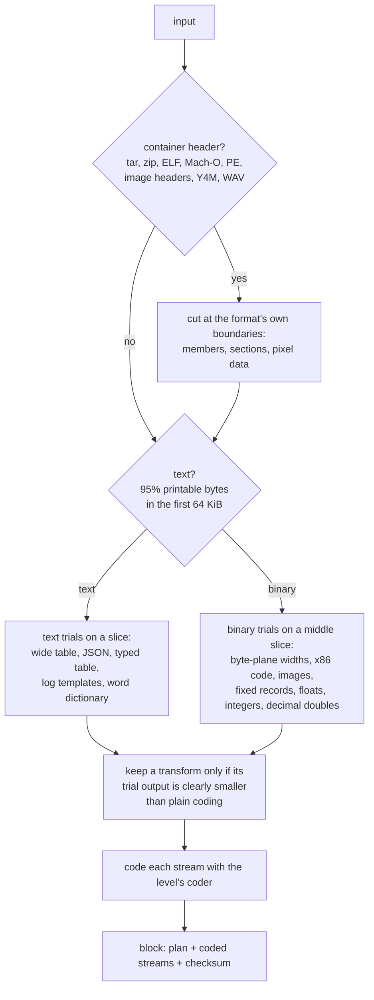
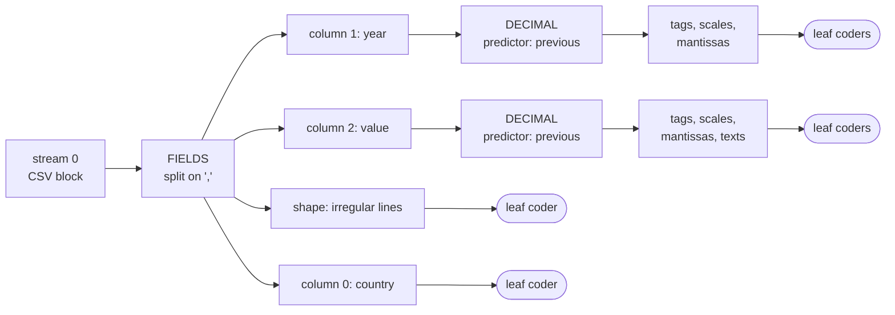

> **DRAFT. Not published.** A technical blog post for the launch (adoption plan, phase 3). Every number comes from
> the 0.0.2 market report (Apple M5, one thread, lzbench 2.4.1). Before publishing:
> - replace or add the x86-64 numbers when that run is done;
> - link the public benchmark page;
> - check each route named below with `kolmo -l` on the 0.0.2 binary.
>
> Some descriptions of routes follow `docs/ROUTING-MAP.md`, which was written before 0.0.1 renamed the coders. The
> owner approves the text before it goes anywhere.

# How Kolmo finds the structure in your data

Most general-purpose compressors treat their input as a stream of bytes. They look for repeated strings, model which
byte tends to follow which, and code the result with Huffman or arithmetic coding. That works well on text and on
much else, and the best of them (zstd, xz, brotli) are very well engineered.

A lot of real data is not a stream of bytes in any useful sense, though. A CSV file is a table: its column 3 is a
number that rises by about the same amount on every row. A star catalog is an array of 28-byte records, each holding
floats and integers at fixed offsets. A 12-bit medical image is a grid of 16-bit samples, where each pixel is close to
the pixels above and to its left. An LZ coder sees none of this. To it, two consecutive rows of the table are two
strings that differ in a few digits, and two neighbouring pixels are two byte pairs that are rarely equal.

Kolmo is a compressor built on one idea: **find that structure without being told, rewrite the data so the structure
is explicit, then hand it to an ordinary entropy coder.** No schema, no profile and no training step. You run
`kolmo FILE`, and the planner decides, block by block, what the data is.

This post explains how that works: how the planner looks at data, what transforms it can choose, how a block can hold
a small program instead of one fixed transform, and how the coders change with the level.

## What it buys, measured

First, the numbers, so you know whether the rest is worth reading. These are the files of the Silesia corpus where
Kolmo's default level gains most over zstd's default:

| Silesia file | What it is | Kolmo -3 ratio | zstd -3 ratio | Kolmo gain |
|---|---|---:|---:|---:|
| sao | binary star catalog | 2.933 | 1.312 | **+124%** |
| x-ray | 12-bit medical image | 2.305 | 1.393 | **+65%** |
| mr | MRI image | 4.259 | 2.811 | **+52%** |
| nci | chemical database | 15.845 | 11.840 | **+34%** |
| ooffice | executable | 2.244 | 1.968 | +14% |
| dickens, webster, reymont, osdb, mozilla | text and records | | | 0 to 3% |
| xml | markup | 8.302 | 8.414 | −1% |

*Method:* Kolmo 0.0.2 built from the release tag with generic flags (`make ARCH=`), run inside lzbench 2.4.1 next
to the other codecs, so every codec has the same harness and compiler flags. Apple M5, macOS, **one thread for every
codec**. Ratio = original size ÷ compressed size; gain = Kolmo's ratio ÷ zstd's ratio − 1. Every output was decoded
and compared with the original. The full report, with raw results and scripts, is in the repository.

The last rows matter as much as the first. On English text, on database pages and on XML, Kolmo's default level is
about as good as zstd -3, and on xml it is slightly worse. Where there is no structure to find, Kolmo is a good LZ
compressor and nothing more. Everything interesting happens in the first four rows. On sao and x-ray, Kolmo's
*default* level is also smaller than `zstd -19` and `xz -9`: sao is 2.933 against 1.450 and 1.643, and x-ray is 2.305
against 1.652 and 1.887.

## The shape of the pipeline

Kolmo cuts its input into blocks. Each block is planned, transformed, coded and checksummed on its own, so blocks
compress and decompress in parallel and any byte range can be decoded alone. The plan of a block is stored in the
block, so the decoder never needs to repeat the analysis. It reads the plan, decodes the coded streams and runs the
inverse transform.



Three rules shape everything in that diagram.

**Content only.** The planner never reads a file name or an extension. The same bytes give the same compressed frame
whatever they are called. Where a format states its own structure in a header, Kolmo reads the header: image width
and channels, tar member boundaries, the sections of an executable. Each header parser treats the header as untrusted.
It checks every offset and length against the input, caps every count, and treats a header that does not parse as
absent.

**Trial, don't guess.** Almost every decision is made by doing the work on a sample and measuring the result. Kolmo
does not ask whether a file looks like a table. It asks whether coding the table transform's output is smaller than
coding the plain bytes, on a slice of the input. A transform has to win by a clear margin to be chosen, so a near tie
falls back to plain coding.

**Every input round-trips.** A transform must reproduce every byte, including the ones that do not fit its model:
quoted CSV fields, short rows, a NaN in a float column, a line that does not match the log template. Those go to an
exception stream. The table transform can turn a CSV with a few odd rows into columns. It still makes a smaller file,
and the file still decodes exactly.

## Text: tables, logs, JSON and words

A block counts as text when at least 95% of the bytes in its first 64 KiB are printable. The planner then runs a
series of trials, cheapest first, on a slice of up to 1 MiB taken from the middle of the input (the start of a file is
often atypical: headers, comments).

**Tables.** If at least 95% of lines have the same number of fields under one of the usual delimiters (`,`, tab, `;`,
`|`, space), the block is a table candidate. The typed-table transform turns it into columns. Each numeric column
becomes exact decimals at a common scale, predicted by one of several models chosen per column:

- the raw value;
- the delta from the previous row;
- the delta within an entity (the same country on an earlier row);
- delta-of-delta and third-order differences, for counters and steady trends;
- a **formula of other columns**, discovered by search (`y = k·a/b`, change, percent change). On the OWID energy table
  it finds 51 of them.

A column that is a ratio of two other columns costs almost nothing to store once the formula is known. Tables with
more than 256 columns get a separate wide-table route.

**Logs.** Log lines are split into **templates and variables**. `Connection from 10.0.0.7 port 5133` becomes a
template id plus an IP and a port, and timestamps, IPs and ids become integer columns. The template trial must be
clearly smaller than plain coding to be kept.

**JSON.** Minified JSON with repeated records is split into records, and JSON lines are tokenised like logs. Both are
chosen only when the trial is smaller.

**Fixed-width text.** Chemistry files, geometry files and fixed-width reports come in a few line lengths. They are
stored column by column for each line length. This is a line scan and a transpose, several times cheaper than
templates. This is the route Kolmo takes on Silesia's `nci`, and it is where the +34% comes from.

**Prose.** At the higher levels, frequent words become 2-byte codes, taken from byte values the block never uses.
Below that, prose goes to the LZ coder as it is, because there is little structure to gain from at that speed.

## Binary: finding the element width

Binary data has no delimiters, so the planner finds structure statistically. First it asks **what the element width
is**. Byte-plane shuffling regroups the bytes of 2-, 4- or 8-byte elements, so all the first bytes come together, then
all the second bytes, and so on. For any width where the planes are more predictable than the original bytes, the
shuffle is tried. It is kept when its trial is at least 5% smaller than plain coding.

On inputs of 256 KiB or more, a richer set of candidates is scored on a 1 MiB slice from the middle:

- **x86 code**, detected by the density of `E8`/`E9` call and jump opcodes and handled by the classic call/jump
  transform. ARM64 code gets its own branch filter, which works on `BL` and `ADRP` and is applied to the code sections
  found in ELF, Mach-O or PE headers.
- **8- and 16-bit images**, with the row length found by a lag search: the row stride is the lag at which the data
  best predicts itself. Each pixel is then predicted from its left, upper and upper-left neighbours with the LOCO-I
  median predictor, and only the residual is coded. When an image header gives the geometry, the search is skipped.
  This is the route Silesia's `x-ray` and `mr` take, and where their +65% and +52% come from.
- **Fixed records**, whose period is found by self-similarity. The bytes at offset *k* of every record are compared,
  and each field of 1, 2, 4 or 8 bytes is stored raw, as deltas, as dictionary tokens, or as multiples of a discovered
  quantum. Silesia's `sao` is a catalog of 28-byte records holding floats and integers. It is the file where Kolmo's
  default level is 2.2x smaller than zstd's.
- **Floats** (float16, float32, float64). The exponent bytes are usually predictable and the mantissa bytes usually
  are not, so they are separated.
- **Integer arrays**, stored as residuals from a predictor: the previous value, or a linear extrapolation. Values are
  first divided by their common divisor and offset by a bias.
- **Decimal doubles**: float64 arrays whose values were written in decimal, such as `.npy` tables, pickles and
  columns inside `.npz` files. They are stored as **integers over a power of ten**, so `0.1` becomes the integer 1 at
  scale 1, with missing values as a tag and anything that does not fit kept verbatim.

The cheapest candidate that beats plain coding by a margin wins. Four small probes elsewhere in the file mark inputs
whose middle is not representative; those blocks are then coded both ways, and the smaller is kept.

## Graph blocks: a small program per block

Early versions of Kolmo had one transform per block. That breaks down quickly. A CSV has numeric columns, text
columns and date columns, and each wants a different treatment. A NumPy file has a header followed by an array. A
pickle holds arrays at odd byte offsets inside other data.

So a block can hold a **graph**: a small program rather than a single transform. Stream 0 is the block's input. Each
node takes one or more streams and produces new ones. The streams that no node consumes are the **leaves**, and each
leaf is coded by an ordinary coder, chosen per leaf. The decoder decodes the leaves, then runs each node's inverse in
reverse order.



The node types in the format include:

- `FIELDS`: split delimited lines into columns;
- `DECIMAL`: turn a text column of numbers into tags, scales and integer mantissas, predicted from the previous value;
- `INT`: integer residuals of order 0, 1 or 2, with a common divisor and byte planes;
- `FLOAT`: rotate the sign bit next to the exponent, then split into byte planes;
- `IMG8`: the LOCO-I median predictor on 8-bit rows;
- `DEC64`: decimal doubles as integers over a power of ten, by column or by segment;
- `CONCAT`: join streams back together.

A program is chosen by the same trials as everything else. Each candidate graph is run on a 32 KiB screen first, and
only the promising ones are run on the full trial slice.

Graphs are also how the format grows safely. A new transform is a new node id. A decoder that meets a node id it does
not know refuses the block with an error, so it never misreads it. This is the basis of Kolmo's format promise: every
later release reads every frame written since 0.0.1 to the same bytes, and a new feature always uses an identifier
that older releases refuse (`COMPATIBILITY.md`).

## Coders: what the level changes

The planner decides **what the data is**. The level decides **how hard to code it**. All the coders are Kolmo's own;
since 0.0.1 there is no zstd, LZ4, Brotli or liblzma in the code, the build or the packages.

| Level | Analysis | Coder | Decode, MiB/s (Silesia, one thread) |
|---|---|---|---|
| `-1` fastest | minimal | KLZ, a byte-aligned LZ77 | 4164 |
| `-2` | minimal | KLZH2 fast parse (LZ77 with Huffman-coded streams) | 1718 |
| `-3` light (default) | full | KLZH2 3 | 1506 |
| `-4` to `-7` | full | KLZH2 5, 7, 8, 9 (stronger parsers, larger windows) | 1406 to 1487 |
| `-8` | full | block sorting (LZP, BWT with libsais-derived suffix sorting, QLFC) for every block | 46 |
| `-9` max | full | block sorting for text; KLZMA (LZMA-class) or block sorting otherwise, whichever is smaller | 85 |
| `-U` ultra | full | context mixing (orders 1 to 7, words, columns, neural mixing), with the others as trials | 1.2 |

Two things follow from this design.

First, **the structure gain stacks with the coder gain**. A table that the typed-table transform has already turned
into small integer residuals compresses much better than raw CSV under every coder. The light level's ratio of 10.75 on the
OWID CO2 table, against zstd -3's 3.17 (command-line runs, one thread, best of 3), comes almost entirely from the
transform. The higher levels then add the usual
coder gains on top.

Second, **levels 1 to 7 all decode at LZ speed**. The extra time at higher levels is spent compressing: more trials,
better parsing, larger windows. Decoding is not slowed down. That is where Kolmo's most useful claim comes from. On
Silesia, `kolmo -6` produces output smaller than `xz -9` (ratio 4.367 against 4.346) and decodes 8.6 times faster
(1463 MiB/s against 169), on one thread in the same lzbench harness. At level 4 Kolmo is within 1.6% of `zstd -19`'s
ratio and compresses 13 times faster (79 MiB/s against 6.0).

Levels 8 and 9 switch to block sorting. They are smaller again, but they decode about ten times more slowly. Even so,
`kolmo -9` matches `zpaq -5`'s ratio on Silesia (5.232 against 5.237) and decodes 120 times faster.

## Where it does not help

A structure detector earns trust by saying where it finds nothing. These come from the same report.

- **Plain text at the low levels.** On enwik8 and on Silesia's text files, Kolmo -3 is within a few percent of zstd -3.
  There is no table or array to find.
- **Decode speed against zstd.** At levels 2 to 7 Kolmo decodes 30 to 40% slower than zstd on one thread. Its blocks
  decode in parallel, so on many cores it pulls ahead, but on a single core zstd is faster.
- **The fast tier.** Kolmo's level 1 is beaten by lzav -1 on both ratio and speed on Silesia.
- **Small files.** On the Canterbury corpus (2.8 MB of small files) Kolmo -3 is 4% larger than zstd -3, and levels 6
  and 7 are not in order.
- **Model weights.** On f32 and bf16 safetensors every tool we measured lands at about the same ratio, Kolmo included.
- **Memory.** Level 9 uses about 1.4 GB to compress Silesia.

## Try it

```sh
brew install adnaneben/kolmo/kolmo        # or: pip install kolmoc, cargo add kolmo
kolmo -v data.csv                         # writes data.csv.kolmo, prints sizes and speed
kolmo -l data.csv.kolmo                   # shows the engine and the block codecs that were chosen
```

`kolmo -l` shows what the planner chose for each file. The detection order, and what each data type gets at each
level, is documented in `docs/ROUTING-MAP.md`. The format is specified in `FORMAT.md`. If you have data that Kolmo
should do better on, a performance issue with a public sample is the most useful thing you can send.
